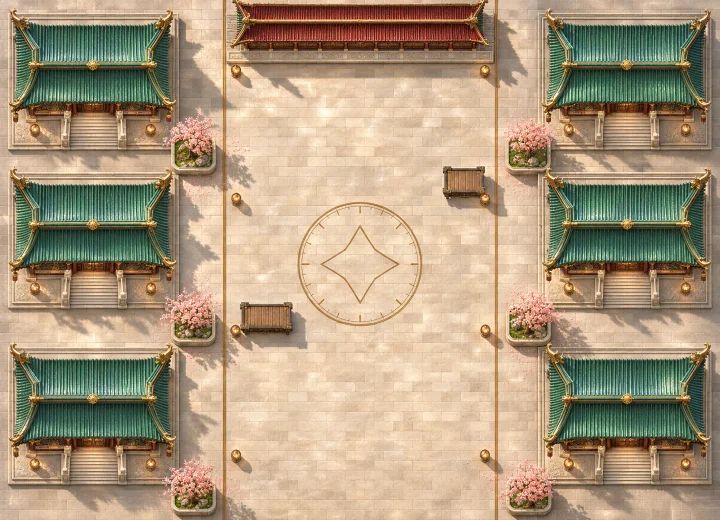

# Императорская столица

Глава для трёх персонажей 14-го уровня в D&D 5e. Три охотника держат улицы внутреннего города. За ними идут Зал пурпурных знамён, дуэль с Ли Шэнем (CR 20) и покои Бога Молний (CR 50).



## Установка

1. В Foundry откройте **Add-on Modules → Install Module** и вставьте URL манифеста в поле **Manifest URL**.

   ```text
   https://github.com/elfurion/imperial-capital/releases/latest/download/module.json
   ```

2. В мире D&D 5e включите **Императорская столица** и **Midi-QOL** в **Manage Modules**.
3. В **Compendium Packs** откройте **Императорская столица · импорт всей главы**. Откройте Adventure **Императорская столица** и нажмите **Import Adventure**. Пять сцен, токены противников, актёры, журнал и макросы появятся в мире.
4. Откройте журнал **Императорская столица · журнал ведущего**. Вход группы и тактика противника указаны на странице каждой сцены.

Пак рассчитан на Foundry V13, D&D 5e 5.2.x и Midi-QOL 13.0.29+. В 5.3.x используйте ветку Midi-QOL 13, совместимую с вашей версией системы.

## Сцены

| Сцена | Размер сетки | Противник |
| --- | ---: | --- |
| [Проспект белого камня](assets/maps/avenue.webp) | 36 × 26 | Суй Жэнь, охотник-заклинатель, CR 14 |
| [Канал двух фонарей](assets/maps/canal.webp) | 40 × 28 | Мэй Янь, охотница-заклинательница, CR 15 |
| [Двор Бронзового колокола](assets/maps/court.webp) | 34 × 26 | Гао Вэнь, заклинатель-мечник, CR 16 |
| [Зал пурпурных знамён](assets/maps/hall.webp) | 36 × 26 | Ли Шэнь, Страж Императора, CR 20 |
| [Покои Бога Молний](assets/maps/throne.webp) | 44 × 34 | Император, Бог Молний, CR 50 |

Карты WebP, квадратная сетка 100 px на клетку, 5 футов на клетку, поля 0%. Token Vision и Fog Exploration отключены на всех сценах. Стены у зданий и колонн ограничивают перемещение. Подсказки по укрытиям и воде находятся в журнале.

## Midi-QOL и бой в покоях

- Оставьте включённой замену стандартных активностей на Midi-QOL, если ваша версия Midi-QOL показывает эту настройку. Включите обработку атак и спасбросков, бросок урона и автоматическую выдачу урона либо кнопки применения урона в чате. Для остальных атак по области включите автотаргет по шаблону или выбирайте цели вручную.
- Для многоатак отдельно запускайте каждый удар из листа противника. Реакции, которые отменяют чужой бросок или заклинание, объявляйте до применения урона. Перемещения и эффекты, подписанные как действия ведущего, разрешайте после workflow. Легендарные действия расходуют очки через активность.
- Макрос **Стереть · объявить / ударить** запускается на токене Императора. Первый запуск отмечает конус 100 м. Можно предварительно взять один токен на прицел клавишей **T** или указать направление в диалоге. Повторный запуск на следующем ходу выдаёт 9999 урона силовым полем через Midi-QOL всем существам внутри видимой фигуры по центру их токенов. Сохранённый шаблон остаётся на месте до удара.
- За каждую из трёх печатей отвечает отдельный герой. Подойдите в пределах 10 футов, выделите его токен и запустите **Развернуть печать** на его ходу. Третья печать обнуляет HP Императора и убирает шаблон. **Покои · сброс арены** возвращает печати, HP и легендарные ресурсы к началу сцены.
- Перед первой игрой выполните пробный запуск финала в тестовом мире со своими настройками Midi-QOL. Запустите **Покои · сброс арены** после проверки.

## Сборка

```sh
npm ci --cache .npm-cache
npm run build
```

Готовые карты и портрет Ли Шэня входят в репозиторий. В архив релиза входят `module.json`, `arena.mjs`, `assets/` и скомпилированный пак `packs/`.
